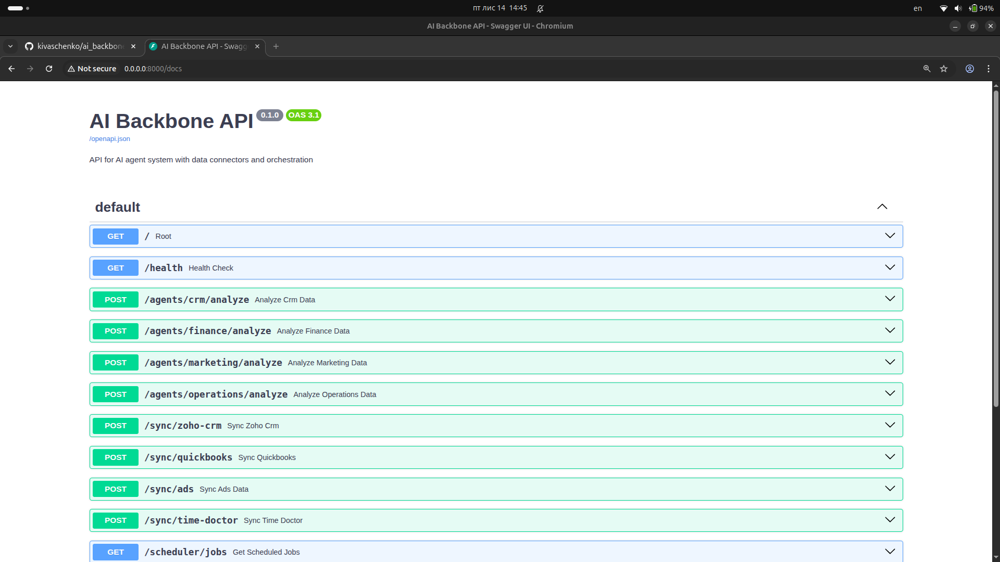

# AI Backbone

AI Backbone is a Python system for automating business operations across CRM, finance, marketing, and operations platforms. It combines data connectors, a normalized PostgreSQL data model, scheduled workflows, AI agents, and REST API endpoints.

## Architecture

The project is organized into five layers:

1. **Data connectors** in `core/connectors/` — Pull and push data from Zoho CRM, QuickBooks, Google Ads, Meta Ads, Time Doctor, and Google Sheets.
2. **Unified data layer** in `core/database/` — Store normalized CRM, finance, marketing, and operations records in PostgreSQL.
3. **Orchestration** in `core/orchestration/` — Schedule jobs, execute asynchronous tasks with retries, and run dependent workflows.
4. **AI agents** in `core/agents/` — Generate insights for sales, finance, marketing, and operations data.
5. **API and dashboard** in `core/api/` — Expose agent analysis, data synchronization, scheduling, health, and dashboard endpoints.

## Features

- Multi-platform integrations for CRM, accounting, advertising, and time tracking
- Unified schemas for cross-platform business analysis
- LLM-powered agents for contextual insights
- Cron and interval scheduling with asynchronous task queues
- Multi-step workflows with dependency handling
- Real-time and cohort dashboard endpoints
- Extensible connectors and agents

## Repository Structure

```text
ai_backbone/
├── core/
│   ├── agents/          # CRM, finance, marketing, and operations agents
│   ├── api/             # FastAPI application and routes
│   ├── connectors/      # External platform integrations
│   ├── database/        # PostgreSQL models and connections
│   ├── orchestration/   # Scheduler, task queue, and workflows
│   └── utils/           # Shared utilities
├── screenshots/         # Documentation assets
├── scripts/             # Database and maintenance scripts
├── requirements.txt     # Python dependencies
├── .env.example         # Environment variable template
└── README.md
```

## Prerequisites

- Python 3.9 or newer
- PostgreSQL 13 or newer
- API credentials for the integrations you intend to use
- An LLM API key if you enable agent analysis

## Installation

```bash
git clone https://github.com/kivaschenko/ai_backbone.git
cd ai_backbone

python -m venv venv
source venv/bin/activate
# On Windows: venv\Scripts\activate

pip install -r requirements.txt
cp .env.example .env
```

Update `.env` with your database, LLM, and platform credentials. Configuration keys are documented in `.env.example`.

Initialize the database:

```bash
python scripts/init_db.py
```

Start the API server:

```bash
python -m core.api.main
```

The interactive API documentation is available at `http://localhost:8000/docs`.



## Usage

### Analyze CRM data

```python
from core.agents.crm_agent import CRMAgent

agent = CRMAgent(
    agent_id="crm_1",
    llm_config={
        "model": "gpt-4",
        "api_key": "your-api-key",
    },
)

result = agent.process({
    "deals": [...],
    "query": "What are the top at-risk deals this month?",
})

print(result["insights"])
```

### Schedule data synchronization

```python
from core.orchestration.scheduler import scheduler

scheduler.add_interval_job(
    job_id="zoho_sync",
    func=sync_zoho_crm,
    hours=1,
)

scheduler.add_cron_job(
    job_id="daily_report",
    func=generate_financial_report,
    hour="9",
    minute="0",
)

scheduler.start()
```

### Create a workflow

```python
from core.orchestration.workflow import Workflow

workflow = Workflow(
    workflow_id="monthly_analysis",
    name="Monthly Business Analysis",
)

workflow.add_step("fetch_crm", "Fetch CRM Data", fetch_crm_data)
workflow.add_step("fetch_finance", "Fetch Finance Data", fetch_finance_data)
workflow.add_step(
    "analyze",
    "AI Analysis",
    run_analysis,
    depends_on=["fetch_crm", "fetch_finance"],
)
workflow.add_step(
    "report",
    "Generate Report",
    create_report,
    depends_on=["analyze"],
)

workflow.execute()
```

## API Endpoints

### Health

```text
GET /health
```

### Agent analysis

```text
POST /agents/crm/analyze
POST /agents/finance/analyze
POST /agents/marketing/analyze
POST /agents/operations/analyze
```

### Data synchronization

```text
POST /sync/zoho-crm
POST /sync/quickbooks
POST /sync/ads
POST /sync/time-doctor
```

### Dashboards

```text
GET /dashboard/cohort/overview
GET /dashboard/metrics/realtime
```

## Development

### Run tests

```bash
pytest tests/
```

### Format and lint

```bash
black core/
flake8 core/
mypy core/
```

## Roadmap

- [ ] Add connectors for HubSpot and Stripe
- [ ] Implement real-time webhooks
- [ ] Build an interactive dashboard UI
- [ ] Add persistent agent memory
- [ ] Implement multi-agent collaboration
- [ ] Add predictive analytics models

## Contributing

Contributions are welcome. Please open an issue to discuss significant changes before submitting a pull request. Keep changes focused and include tests where appropriate.

## License

This project is licensed under the [MIT License](LICENSE).
